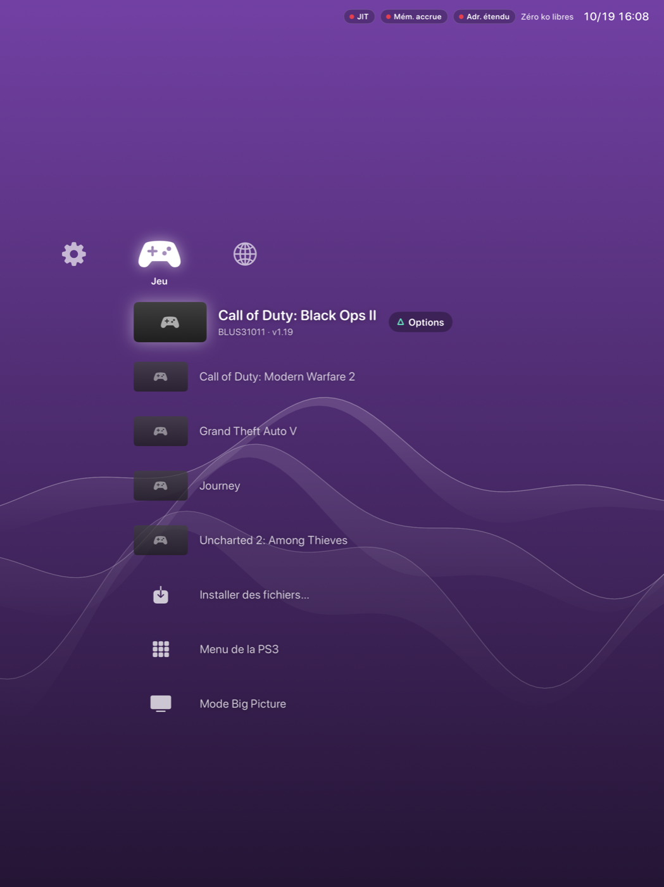

> [!WARNING]
> **Projet personnel « vibecodé ».** Tout le code de ce dépôt (ou, pour un fork, toutes les modifications) a été écrit par **Claude** (Anthropic, via Claude Code), à la demande spécifique de [@NOxygen59](https://github.com/NOxygen59), pour **son appareil précis** :
>
> **iPad Pro 12,9" 5ᵉ génération (puce M1) — 512 Go de stockage, 8 Go de RAM — iOS 16.6.1, jailbreak Dopamine (rootless) + TrollStore.**
>
> Rien n'est testé ni prévu pour un autre appareil. Pas de support, pas de feuille de route : c'est un dépôt d'archive personnel, publié pour pouvoir reprendre le travail plus tard (modifications, mises à jour).

**Projet :** pas un fork git, mais construit sur le fork [NOxygen59/rpcs3](https://github.com/NOxygen59/rpcs3) de [XITRIX/rpcs3](https://github.com/XITRIX/rpcs3) (lui-même fork de [RPCS3/rpcs3](https://github.com/RPCS3/rpcs3)), et sur les releases de [XITRIX/RPCS3-iOS-Releases](https://github.com/XITRIX/RPCS3-iOS-Releases).

---

# RPCS3 pour iOS 16

L'émulateur PlayStation 3 [RPCS3](https://github.com/RPCS3/rpcs3), dans le portage iOS de [XITRIX](https://github.com/XITRIX/RPCS3-iOS-Releases). Ce dépôt le fait tourner sur **iOS 16** : la v0.11 officielle demande iOS 17.4, et son interface ne peut pas tourner sur iOS 16.

- **Le cœur** : le même que la v0.11 (ABI 30), recompilé tel quel pour iOS 16.0. Il vient de [NOxygen59/rpcs3](https://github.com/NOxygen59/rpcs3), branche `ipad-ios16`, qui fige le commit `af64aca` de la branche `ios-port` de XITRIX.
- **L'app** : une interface SwiftUI réécrite pour iOS 16, en français (`App/`). Elle reprend les fonctions de la v0.11 :
  - démarrage avec ou sans JIT (TrollStore « Open with JIT ») ;
  - installation de firmware, PKG, RAP, ISO + clé, ZIP et dossiers ;
  - bibliothèque, XMB, mode Big Picture ;
  - sauvegardes d'état, réglages par jeu et préréglages ;
  - patchs, mises à jour Sony, trophées, caches ;
  - manettes et manette tactile ;
  - RPCN ;
  - journal.

## Versions

Numérotation propre, « RPCS3 iOS 16 », en parallèle des releases officielles de XITRIX :

| RPCS3 iOS 16 | Basé sur RPCS3 iOS (XITRIX) | Release | Contenu |
|---|---|---|---|
| 1.1 | 0.11 (cœur ABI 30, `af64aca`) | [v0.11.1-ios16.1](https://github.com/NOxygen59/rpcs3-ios16/releases/tag/v0.11.1-ios16.1) | Accueil façon XMB de la PS3, fond animé selon le mois et l'heure, indicateurs JIT / mémoire accrue / adressage étendu, navigation à la manette |
| 1.0 | 0.11 (cœur ABI 30, `af64aca`) | [v0.11.1-ios16](https://github.com/NOxygen59/rpcs3-ios16/releases/tag/v0.11.1-ios16) | Cœur recompilé pour iOS 16, interface SwiftUI en français, optimisé batterie, son corrigé |

## L'accueil



L'écran d'accueil reprend le **XMB de la PS3** :
- **Catégories :** Paramètres, Jeu et Réseau en ligne, les éléments de la catégorie en colonne, ceux d'avant la sélection au-dessus de la barre.
- **Fond :** le thème « Original », un dégradé à la couleur du mois et à la luminosité de l'heure, avec des vagues animées. Elles tournent à 20 images par seconde, rendues par la puce graphique, et se mettent en pause pendant un jeu ou en arrière-plan. Paramètres › Thème permet de les figer.
- **En haut à droite :** la date et l'heure, et les indicateurs **JIT**, **mémoire accrue** (`increased-memory-limit`) et **adressage étendu** (`extended-virtual-addressing`), en vert quand ils sont accordés, avec la mémoire encore disponible.
- **Manette :** la croix directionnelle ou le stick se déplacent dans la barre, ✕ ouvre, △ affiche les options d'un jeu. Au doigt, on glisse ou on touche, et toucher l'élément sélectionné l'ouvre.

## Installer

Prendre le `.tipa` dans les [Releases](https://github.com/NOxygen59/rpcs3-ios16/releases), l'installer avec TrollStore, puis lancer RPCS3 par un appui long › **Open with JIT**.

## Reconstruire

Prérequis : Xcode (SDK iOS récent ; la cible reste iOS 16.0), CMake, Ninja (`brew install cmake ninja`).

**L'app seule (une minute) :**
1. Récupérer le cœur déjà compilé : `libRPCS3Core.dylib`, joint à chaque release.
2. Lancer :

```sh
RPCS3_CORE=/chemin/vers/libRPCS3Core.dylib packaging/package.sh   # → dist/RPCS3-<version>-ios16.tipa
```

**Le cœur (long : environ 3100 étapes, LLVM compris, le Mac chauffe) :**

```sh
deps/build-core.sh          # clone NOxygen59/rpcs3 (ipad-ios16) dans ../rpcs3-ios, MoltenVK 1.4.2, FFmpeg 8.1.1
packaging/package.sh        # utilise ../rpcs3-ios/build-ios/rpcs3/libRPCS3Core.dylib
```

Le script tourne en priorité basse, avec la moitié des cœurs (`JOBS=n` pour changer). Interrompu, il reprend là où il s'était arrêté. Trois options CMake sont indispensables pour iOS, et le script les passe déjà :
- `CMAKE_MACOSX_BUNDLE=OFF` : sinon les outils de LLVM sont pris pour des apps ;
- `LLVM_NO_DEAD_STRIP=ON` : sinon `ld` refuse `--gc-sections` ;
- les triples LLVM `arm64-apple-ios16.0`.

## Organisation

| Dossier | Contenu |
|---|---|
| `App/Core.swift` | Le cœur vu de Swift : l'API C `RPCS3IOS.h` (ABI 30) enveloppée. |
| `App/AppModel.swift` | Le démarrage (JIT ou non), la bibliothèque, les installations. |
| `App/EmulationView.swift` | L'écran de jeu : CAMetalLayer, session audio, suivi de l'émulation, affichage des performances. |
| `App/Input.swift` | Manettes GameController (vibrations CoreHaptics) et manette tactile, envoyées au cœur par événement. |
| `App/Online.swift` | Base de configuration RPCS3, dépôt de patchs, mises à jour Sony. |
| `App/SettingsView.swift`, `SettingNames.swift` | Les 160 réglages du cœur, traduits en français. |
| `App/GameDetailView.swift`, `RPCNView.swift`, `RPCS3App.swift` | Les autres écrans. |
| `include/` | `RPCS3IOS.h` (copié du cœur) et le pont C vers Swift. |
| `packaging/` | `package.sh`, `Info.plist`, les entitlements (`get-task-allow` pour le JIT), l'icône, et les ressources de la v0.11 : icônes des menus en jeu et traductions du cœur (`RPCS3Core.strings`). |
| `deps/` | Scripts de MoltenVK, FFmpeg et du cœur. |

## À savoir

- **Son :** l'app doit envoyer les notifications `RPCS3AudioSessionDidActivate` et `RPCS3AudioSessionWillDeactivate` autour de l'activation de `AVAudioSession`. Sinon, le cœur ne démarre jamais l'audio.
- **Compilation du cœur :** il est déjà compilé en `-O3 -march=armv8.4-a`, et son JIT LLVM vise l'`apple-m1`. Le recompiler pour gagner en vitesse n'apporte presque rien.
- **Simulateur :** le cœur ne tourne pas dans le simulateur (build pour appareil seulement), tous les tests se font sur l'iPad.

## Licence

**GPL-2.0** (voir [LICENSE](LICENSE)). L'app est distribuée avec le cœur RPCS3, qui est sous GPL-2.0, et cette licence s'applique à l'ensemble. Les ressources de `packaging/Resources` viennent de la v0.11 de XITRIX (même licence).
